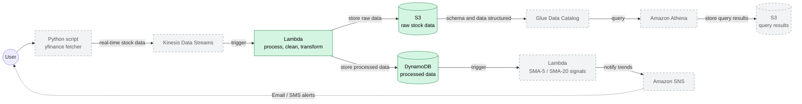

# Real-time stock market data analytics pipeline built on AWS

<!-- Row 1: Status - Most Important -->
[](https://github.com/subhamay-bhattacharyya/aws-stock-analytics-pipeline/releases)&nbsp;[](https://github.com/subhamay-bhattacharyya/aws-stock-analytics-pipeline/actions/workflows/release.yaml)&nbsp;[](https://github.com/subhamay-bhattacharyya/aws-stock-analytics-pipeline/issues)&nbsp;[](https://github.com/subhamay-bhattacharyya/aws-stock-analytics-pipeline/commits)

<!-- Row 2: Code Quality -->
[](https://github.com/subhamay-bhattacharyya/aws-stock-analytics-pipeline)&nbsp;[](https://github.com/subhamay-bhattacharyya/aws-stock-analytics-pipeline/commits)

<!-- Row 3: Tech Stack -->
[](https://aws.amazon.com/cloudformation/)&nbsp;[](https://claude.ai/)

<!-- Row 4: Repository Info -->
[](https://github.com/subhamay-bhattacharyya/aws-stock-analytics-pipeline)&nbsp;[](https://github.com/subhamay-bhattacharyya/aws-stock-analytics-pipeline)&nbsp;[](https://github.com/subhamay-bhattacharyya/aws-stock-analytics-pipeline/releases)

<!-- Row 5: Custom Metrics -->
[](https://gist.github.com/bsubhamay/07e4accbf35b23c2069188b1dd56e2b5)

Real-time stock market data analytics pipeline on AWS. Market data is streamed through Kinesis, processed by Lambda, stored in S3 and DynamoDB, queried with Athena, and turned into trend alerts with SNS.

## Architecture

Green nodes are provisioned by [cloudformation/template.yaml](cloudformation/template.yaml). Grey dashed nodes are part of the target architecture and are not in the template yet.



## Deployed Resources

The root stack in [cloudformation/template.yaml](cloudformation/template.yaml) creates the following through nested stacks:

| Resource | Purpose |
| --- | --- |
| S3 bucket | Versioned storage, public access blocked, optional KMS encryption |
| DynamoDB table (`Receipts`) | Keyed on `symbol` and `timestamp`, with streams and point-in-time recovery |
| Lambda function | Python 3.12 processor, 256 MB, 60 s timeout |
| Lambda execution role | IAM role with S3, DynamoDB, Textract, SES, KMS, and CloudWatch Logs access |
| CloudWatch log group | Lambda logs, 14-day retention |
| S3 invoke permission | Lets the bucket invoke the Lambda function |

The Lambda function is currently triggered by S3 uploads. The Kinesis trigger shown in the diagram is planned.

## Deployment

The nested templates must be uploaded to the S3 bucket named by `NestedStacksS3BucketName` before deploying the root stack. Parameter defaults are in [cloudformation/parameters.json](cloudformation/parameters.json).

```bash
aws cloudformation deploy \
  --template-file cloudformation/template.yaml \
  --stack-name aws-stock-analytics-pipeline-stack \
  --capabilities CAPABILITY_NAMED_IAM
```

## License

MIT
